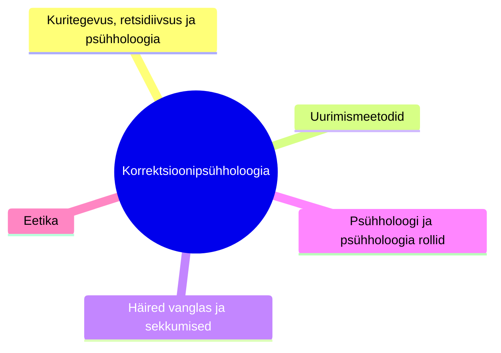
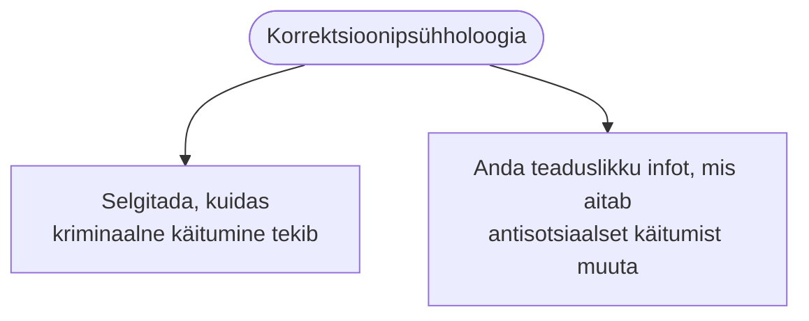
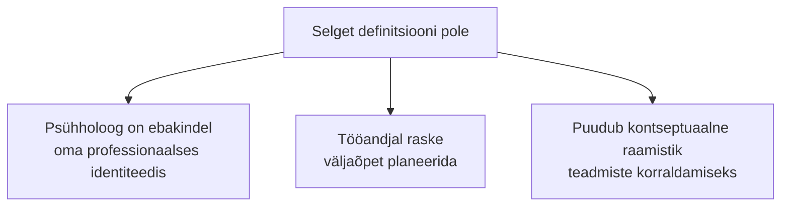
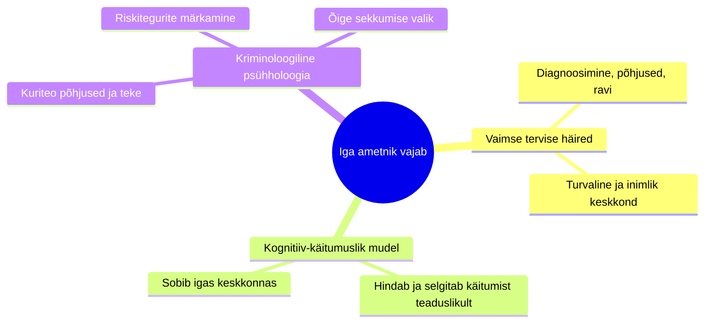
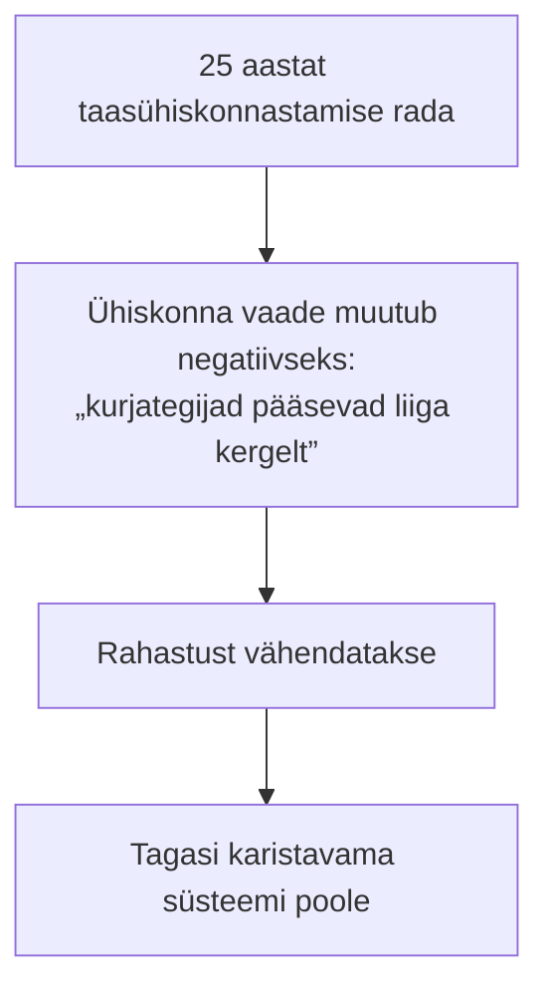
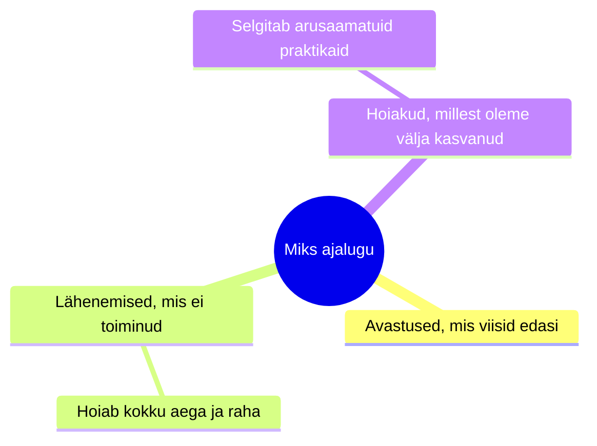

# TUND 1
<!-- Allikas: Vangla_psuhholoogia/01_ajalugu_ja_teooriad/T01_ajalugu.md (5 peatükki) -->
plokk: Mis on korrektsioonipsühholoogia = 1,2,3
plokk: Ajalugu = 4,5

## FAKTID
### Arvud ja nimed
- Kursuse põhiraamat: Polaschek, Day & Hollin (2019), *The Wiley International Handbook of Correctional Psychology* → 1
- Korrektsioonipsühholoogial on 5 tähendust → 2
- Psühholoogias on 3 valdkonda, mida vajab iga korrektsioonisüsteemi ametnik → 3
- Suurbritannia käis 25 aastat taasühiskonnastamise rada, seejärel pöördus karistavama süsteemi poole → 3
- Juhan Liiv: „Kes minevikku ei mäleta, see elab tulevikuta” → 4
- Valgustusaja järgi on karistusel 4 põhjust → 5
- 18. sajand: kuritegu on vaba ja ratsionaalne otsus – kui isiklik võit kaalub üle kaotuse → 5
### Mõisted
- Korrektsioonipsühholoogia põhieesmärk: selgitada kriminaalse käitumise teket ja anda teaduslikku infot, mis aitab antisotsiaalset käitumist muuta → 2
- Kognitiiv-käitumuslik mudel: hindab ja selgitab käitumist teaduslikult; sobib igas keskkonnas ja igale inimtüübile → 3
- Kriminoloogiline psühholoogia: seletab kriminaalse käitumise põhjuseid ja teket → 3
- Utilitaarne vaade: karistus peab olema kuriteoga sobivas proportsioonis → 5
### Loetelud
- 5 tähendust: psühholoogid vanglas, psühholoogia rakendamine iga ametniku poolt, teadus süsteemi parandamiseks, sõltub ühiskonna vaatest, varieeruv → 2
- 3 valdkonda: vaimse tervise häirete teadmised, kognitiiv-käitumuslik mudel, kriminoloogiline psühholoogia → 3
- Ajaloo tundmise 3 eesmärki: avastused, mis viisid edasi; lähenemised, mis ei toiminud; hoiakud, millest oleme välja kasvanud → 4
- Karistuse 4 põhjust: ennetada; suunata kergemate kuritegude poole; vähendada kahju; teha seda väikseima kuluga → 5
- Kursuse õppe ülesehitus: teooria → seostamine varasemate teadmistega → praktiseerimine (oma kogemus või juhtum) → 1
### Põhiväited
- Definitsiooni ebaselguse tõttu on korrektsioonipsühholoogid sageli ebakindlad oma professionaalses identiteedis → 2
- Suur osa korrektsioonist toetub retoorilistele ja tunnetuslikele teadmistele; see viib kallite ja kahjulike praktikateni → 3
- Psühholoogia on ajaloos rääkinud rohkem sellest, KUIDAS kuritegevust vähendada; sotsioloogia selle PÕHJUSTEST → 4
- Vanim vaade: kuritegevuse põhjus on kurjad hinged ja deemonid → rõhk karistamisel → 5
- Vanglad olid esimeste seas, kes lubasid psühholooge oma meetodeid praktiseerima → 5
- Karistus üksinda ei hoia kuritegudest eemale ei varasemaid kurjategijaid ega ühiskonda; vähesed leitud efektid on nõrgad → 5

## TEEMA 1 | sissejuhatus | raamat | Sissejuhatus
pealkiri: Sissejuhatus kursusele
lyhidalt: Korrektsioonipsühholoogia kursus on osa „Isiku hälbiva käitumise” moodulist. Kursus uurib kuritegevuse, retsidiivsuse ja psühholoogia seoseid, uurimismeetodeid, häireid vanglas, psühholoogi rolle ja eetikat.

### Mida kursusel uuritakse
Korrektsioonipsühholoogia kursus kuulub **isiku hälbiva käitumise** moodulisse. Kursuse jooksul uuritakse:
- kuritegevuse, **retsidiivsuse** (korduvkuritegevuse) ja psühholoogia vahelisi seoseid;
- milliste kaasaegsete **uurimismeetoditega** korrektsioonipsühholoogiat uuritakse;
- milliseid **psühholoogilise häirituse ilminguid** vanglas esineb ja millised sekkumisviisid neile sobivad;
- milliseid **rolle** on psühholoogil ja psühholoogial korrektsioonisüsteemis;
- milliseid **eetilisi aspekte** on psühholoogi ametil.

### Kuidas õpe on üles ehitatud
Iga teema puhul käib õpe kolmes sammus:
1. **Õpime teooriat.**
2. **Analüüsime** ja seostame õpitut varasemate teadmistega.
3. **Praktiseerime** õpitut kas oma kogemuse või mõne juhtumi kaudu.

### Põhiraamat
Õppetöö on peamiselt seotud raamatuga: Polaschek, D. L., Day, A., & Hollin, C. R. (2019). *The Wiley International Handbook of Correctional Psychology.*

### SKEEM
```joonis
voog("Iga teema kolm sammu", [("1. Teooria", "õpime teooriat"), ("2. Seostamine", "analüüsime ja seome varasemate teadmistega"), ("3. Praktika", "oma kogemuse või juhtumi kaudu")], varvid=["sinine", "lilla", "roheline"])
```


### INSPEKTOR
Kursuse eesmärk on valmistada ette tööks kinnipeetavaga inspektor-kontaktisikuna. Iga teooria juures tasub küsida: kuidas see aitab mul kinnipeetavat paremini mõista ja tema käitumist muuta?

## TEEMA 2 | mis-on-korrektsioonipsuhholoogia | pea | Mis see on
pealkiri: Mis on korrektsioonipsühholoogia?
lyhidalt: Korrektsioonipsühholoogial on viis tähendust: psühholoogid vanglas, psühholoogia rakendamine iga ametniku poolt, teadus süsteemi parandamiseks, ühiskonna vaatest sõltuv ja varieeruv. Põhieesmärk: selgitada kriminaalse käitumise teket ja anda teadmisi selle muutmiseks.

### Viis tähendust
Korrektsioonipsühholoogial on mitu tähendust:
1. **Psühholoogid** – esiteks tähendab see psühholooge, kes töötavad vangistusega seotud asutustes.
2. **Psühholoogia rakendamine** – teiseks tähendab see psühholoogia kasutamist korrektsioonisüsteemis **ükskõik millise ametniku** poolt.
3. **Teadus** – termin tähendab ka psühholoogiateaduse kasutamist **korrektsioonisüsteemi parandamiseks**.
4. **Sõltub ühiskonna vaatest** – tähendus muutub vastavalt sellele, kuidas ametnikud ja ühiskond psühholoogiat defineerivad ja selle rolli korrektsioonisüsteemis näevad.
5. **Varieeruv** – head definitsiooni ikka veel ei ole, sest ülesanded erinevad süsteemiti ja riigiti.

### Miks ebaselge definitsioon on probleem
Kuna terminil pole selget definitsiooni:
- on korrektsioonipsühholoogid sageli **ebakindlad oma professionaalses identiteedis** ja satuvad töötama keskkondades, mis ei toeta nende töö viise;
- on **tööandjatel raske planeerida** psühholoogide väljaõpet;
- puudub **kontseptuaalne raamistik**, mille järgi psühholoogilisi teadmisi korraldada, et psühholoog saaks korrektsioonisüsteemis oma eesmärke täita.

### Põhieesmärk
Korrektsioonipsühholoogia roll on **selgitada kriminaalse käitumise tekkimist** ning lisaks anda **teaduslikku infot selle kohta, mis aitab inimeste antisotsiaalset käitumist muuta**.

### SKEEM
```joonis
radiaal("Korrektsioonipsühholoogia viis tähendust", "Korrektsiooni-psühholoogia", ["1. Psühholoogid vanglas", "2. Psühholoogia rakendamine iga ametniku poolt", "3. Teadus süsteemi parandamiseks", "4. Sõltub ühiskonna vaatest", "5. Varieeruv – head definitsiooni pole"], varv_kesk="sinine", varv="lilla", suund="välja")
```



### INSPEKTOR
Inspektor-kontaktisik ei ole psühholoog, kuid ta **rakendab psühholoogiat** iga päev: kuidas rääkida, kuidas motiveerida, kuidas märgata vaimse tervise muret. See on korrektsioonipsühholoogia teine tähendus.
olukord: Uus kolleeg ütleb: „Psühholoogia on psühholoogi asi. Minu töö on kord majas.”
mida teha: Korrektsioonipsühholoogia ei ole ainult psühholoogi töö – see on psühholoogia rakendamine iga ametniku poolt. Kord ja psühholoogia ei välista teineteist: kui ametnik mõistab käitumise põhjust, on korda ka lihtsam hoida.

## TEEMA 3 | kolm-valdkonda | sambad | Kasutamine
pealkiri: Korrektsioonipsühholoogia kasutamine
lyhidalt: Iga korrektsioonisüsteemi ametnik vajab kolme valdkonda: vaimse tervise häirete teadmisi, kognitiiv-käitumuslikku mudelit ja kriminoloogilist psühholoogiat. Teaduspõhisuse asemel toetutakse sageli kõhutundele – see on kallis ja võib kahjustada.

### Kolm valdkonda, mida vajab iga ametnik
1. **Psühhiaatrilised ja psühholoogilised teadmised vaimse tervise häiretest** – nende diagnoosimisest, põhjustest ja ravist. Aitab luua **turvalise ja inimliku keskkonna** vangide kinnipidamiseks.
2. **Kognitiiv-käitumuslik mudel** – aitab hinnata ja selgitada inimeste käitumist **teaduslikult tõestatud viisil** ja sekkuda käitumisse ükskõik millises keskkonnas ja iga inimtüübi puhul. Seega sobib see ka kriminaalse käitumise puhul.
3. **Kriminoloogiline psühholoogia** – selgitab kriminaalse käitumise **põhjuseid ja teket**. Seda peaks teadma iga ametnik. Ilma selleta:
   - ei märka me **riskitegureid** ega oska neid eristada muudest vajadustest;
   - võime kasutada **ebaefektiivseid** sekkumisi;
   - võime **valesti hinnata**, kui suurt sekkumist on vaja.

### Kõhutunne või teadus
Väga suur osa korrektsioonist toetub **retoorilistele ja tunnetuslikele teadmistele** ning seda juhivad ametnikud, kellel pole kriitilist ega erialast teadmist.

Mõned usuvad, et nende **loogiline mõtlemine, isiklikud väärtused ja kogemus** on olulisemad kui teaduslikult tõestatud teadmised. See viib **kallite ja võimalikult kahjulike** praktikateni.

Sageli toetavad selliseid vaateid ka **poliitikud ja meedia**, ning neid praktikaid jätkatakse ka siis, kui on juba leitud, et need on ebaefektiivsed. Kasutatakse ka meetodeid, mida pole üldse teaduslikult uuritud – meditsiinis selline lähenemine ei toimiks, kuid korrektsioonisüsteemis see on kasutusel.

### Suurbritannia näide
Kui ühiskonna arvamus kinnipidamisasutustest muutub ja hakatakse otsima **lihtsamaid ja odavamaid** lahendusi, minnakse vahel tagasi hästi toimivatest teaduslikult tõestatud süsteemidest.

Näiteks **Suurbritannia** käis **25 aastat taasühiskonnastamise rada**, kuid on nüüd astunud tagasi **karistavama süsteemi** poole. Põhjus: ühiskonna nägemus taasühiskonnastavast vangistusest muutus negatiivseks („kurjategijad pääsevad liiga kergelt”) ja rahastamist vähendati.

### SKEEM

```json
{"tyyp": "vordlus", "pealkiri": "Kaks lähenemist korrektsioonis", "veerud": ["Tunnetuslik (kõhutunne)", "Teaduspõhine"], "read": [
 {"silt": "Millele toetub", "lahtrid": ["loogiline mõtlemine, isiklikud väärtused, kogemus", "teaduslikult tõestatud teadmised"]},
 {"silt": "Kes toetab", "lahtrid": ["sageli poliitikud ja meedia", "uuringud"]},
 {"silt": "Tulemus", "lahtrid": ["kallid ja võimalikult kahjulikud praktikad; jätkuvad ka siis, kui on ebaefektiivsed", "sekkumine, mille toimimist on uuritud"]}]}
```


### INSPEKTOR
Kui kinnipeetav käitub halvasti, ei piisa küsimusest „kuidas teda karistada?”. Kolme valdkonna järgi tuleb küsida: **mis on käitumise põhjus** (kriminoloogiline psühholoogia), **kas taga on vaimse tervise häire** ja **kuidas käitumist muuta** (kognitiiv-käitumuslik mudel).
olukord: Kinnipeetav keeldub korduvalt tööle minemast. Kolleeg soovitab: „Karista teda, küll ta siis läheb.”
mida teha: Kõhutunne pakub karistust. Teaduspõhine ametnik uurib kõigepealt põhjust: kas tegu on depressiooni, hirmu, konflikti või oskuste puudumisega? Alles siis valitakse sobiv sekkumine.

## TEEMA 4 | miks-ajalugu | luup | Miks ajalugu
pealkiri: Miks rääkida ajaloost?
lyhidalt: Ajalugu näitab, kuidas oleme tänasesse jõudnud, mida on juba proovitud ja mis ei toiminud. Psühholoogia on ajaloos rääkinud rohkem sellest, kuidas kuritegevust vähendada; sotsioloogia selle põhjustest.

### Psühholoogia ja sotsioloogia
Korrektsioonis on **psühholoogial** ajaloos olnud rohkem öelda selle kohta, **kuidas kuritegelikku käitumist vähendada**, kui selle põhjuste kohta.

**Sotsioloogia** on rohkem tegelenud kriminaalse käitumise **põhjuste** ja teooriatega.

### Milleks ajalugu
Juhan Liiv on öelnud: „Kes minevikku ei mäleta, see elab tulevikuta.”

Ajalugu on vaja teada, et:
- mõista, **kuidas oleme jõudnud tänasesse** olukorda;
- **mitte katsetada uuesti asju**, mida on juba proovitud ja mis ei toiminud – nii hoiame kokku aega ja raha („jalgratast ei leiutata uuesti”);
- mõista, millised **mõttekäigud ja teadmised** on viinud otsusteni, mis võivad praktikas tunduda arusaamatud.

### Ajaloo teemade eesmärk kursusel
Ajaloost rääkides selgitatakse kogu kursuse vältel:
- millised **avastused** minevikust on aidanud korrektsiooni valdkonnas hüppeid teha;
- milliseid lähenemisi on varem kasutatud, kuid need **ei ole tulemust toonud**;
- millistest **hoiakutest ja meelsusest** oleme välja arenenud.

### SKEEM
```json
{"tyyp": "vordlus", "pealkiri": "Kaks vaatenurka ajaloos", "veerud": ["Psühholoogia", "Sotsioloogia"], "read": [
 {"silt": "Peamine küsimus", "lahtrid": ["**kuidas** kuritegelikku käitumist vähendada", "**miks** kriminaalne käitumine tekib"]},
 {"silt": "Rõhk", "lahtrid": ["käitumise vähendamine", "põhjused ja teooriad"]}]}
```


### INSPEKTOR
Paljud vanglapraktikad on ajaloo jääk. Kui tead, kust praktika tuleb, oskad küsida, kas see täna veel toimib.
olukord: Kolleeg ütleb: „Nii on alati tehtud.”
mida teha: Ajaloo tundmine aitab vastata: „Seda on proovitud ja tulemust see ei andnud” või „See tuleneb ajast, mil usuti, et ainult karistus mõjub.” Nii saab praktikat põhjendatult muuta, mitte ainult harjumusest jätkata.

## TEEMA 5 | ajalugu | liivakell | Ajalugu
pealkiri: Ajalugu
lyhidalt: Kurjategijaga tegelemist on suunanud see, mida peeti kuriteo põhjuseks: deemonid, siis vaba ratsionaalne otsus. Valgustusaeg andis karistusele neli põhjust. Uskumus, et karistus üksi hoiab kuritegudest eemale, ei ole teaduslikult tõestatud.

### Kuritegevuse põhjuste mõju
Seda, kuidas kurjategijaga on tegeletud, on ajaloos suunanud see, **mida ühiskond kuriteo põhjuseks peab**.

Üks **vanimaid** vaateid: kuritegevuse põhjus on **kurjad hinged ja deemonid**, mis juhivad inimese käitumist. Seepärast oli algselt peamine rõhk **karistamisel**. Usuti, et süütu jääb kohtumõistmisel Jumala abil terveks, süüdlane aga saab karistada, sest tema sees on kuri hing.

### Kinnised asutused ja psühholoogia
Kinnised asutused (vanglad, psühhiaatriahaiglad) on olnud psühholoogia arengus väga tähtsad, sest nende sihtrühmad on **keerulisemad kui tavapopulatsioon**. Lisaks olid vanglad **esimeste seas, kes lubasid psühholoogidel** oma hindamismeetodeid, ravivõtteid ja teadust praktiseerida.

Ajalooliselt on vanglates sageli hoitud ka **raskete vaimsete häiretega** inimesi. Seepärast oli vaja teistsuguseid lähenemisi kui lihtsalt vangistus ja karistus – nii tekkis vajadus psühholoogia ja psühhiaatria järele.

### 18. sajand: vaba ja ratsionaalne otsus
18. sajandil usuti, et kriminaalne käitumine on inimese **vaba ja ratsionaalse otsuse** tagajärg: **kui isiklikud võidud kaaluvad üles kaotuse, järgneb kuritegu.**

### Valgustusaeg: karistuse neli põhjust
Valgustusaja filosoofid hakkasid arutlema **karistuse mõju ja eesmärkide** üle. Nende arvates pidi karistus andma rohkem kasu kui lihtsalt valu tekitamine. Karistusel peaks olema **4 põhjust**:
1. **Ennetada** kuritegusid.
2. Kui ennetada ei õnnestu, **suunata** kurjategijat tegema **kergemaid** kuritegusid.
3. **Vähendada kahju**, mida kuritegu tekitab.
4. Ennetada kuritegusid **võimalikult väikese kuluga**.

Tekkis ka **utilitaarne vaade**: karistus peab olema **kuriteoga sobivas proportsioonis**.

Seega arutati juba valgustusajal karistamise üle mõtteid, mis on olulised ka tänapäeval.

### Lähiajalugu
Lähiajaloos on korrektsioonis olnud palju muutusi ja eksperimente, kuid endiselt on levinud uskumus, et **karistada saamine hoiab uutest kuritegudest eemale**. Sellega käib kaasas uskumus, et **karistuse risk hoiab suuremat osa ühiskonnast** kuritegudest eemal.

Küsimus: kas tõesti väldivad kõik kuritegusid ainult selleks, et mitte karistada saada, või on ka muid põhjusi?

### Kas karistus hoiab eemale?
Nendel uskumustel **ei ole erilist teaduslikku tõestust** ja vähesed leitud efektid on **nõrgad**.

See tähendab: **karistada saamine üksinda ei hoia kuritegudest eemale ei neid, kes on varem kuritegusid teinud, ega ühiskonda üldiselt.**

### SKEEM
```joonis
voog("Kuidas vaade kuriteo põhjusele on muutunud", [("Vanim vaade: kurjad hinged ja deemonid", "rõhk karistamisel"), ("Kinnised asutused", "keeruline sihtrühm; vanglad lubasid esimeste seas psühholooge"), ("18. sajand: vaba ja ratsionaalne otsus", "kui võit kaalub üles kaotuse, järgneb kuritegu"), ("Valgustusaeg", "karistusel 4 põhjust; utilitaarne vaade"), ("Lähiajalugu", "püsib uskumus, et karistus hoiab eemale")], varvid=["punane", "oranz", "kollane", "sinine", "lilla"])
```
```joonis
trepp("Karistuse neli põhjust (valgustusaeg)", [("1. Ennetada kuritegusid", ""), ("2. Suunata kergemate kuritegude poole", "kui ennetada ei õnnestu"), ("3. Vähendada kuriteo kahju", ""), ("4. Teha seda väikseima kuluga", "")], varvid=["sinine", "turkiis", "kollane", "roheline"], tipp="Lisaks utilitaarne vaade: karistus kuriteoga proportsioonis.")
```
```joonis
kaks_poolt("Uskumus ja uuringud", ["Karistuse risk hoiab kurjategijad ja ühiskonna kuritegudest eemal"], ["Erilist teaduslikku tõestust pole", "Vähesed leitud efektid on nõrgad"], vp="Uskumus", pp="Uuringud", vv="oranz", pv="sinine")
```

### INSPEKTOR
Inspektor-kontaktisik puutub kokku nii „karistava” kui ka „taasühiskonnastava” vaatega – ajalugu aitab mõista, miks need põrkuvad. Seaduse järgi on vangistuse eesmärk kinnipeetava suunamine õiguskuulekale käitumisele ja õiguskorra kaitsmine ([[VangS § 6 lg 1]]), mitte kannatus.
olukord: Kinnipeetav on kolmandat korda vanglas varguste eest. Ta ütleb: „Vangla mind ei hirmuta, siin on mul sõbrad.”
mida teha: See kinnitab materjali järeldust: karistus üksi ei hoidnud teda eemale. Kontaktisiku töö on täita vangistuse aeg sisuga, mis päriselt muudab käitumist – näiteks täitmiskavas ([[VangS § 16 lg 1]]) ette nähtud hariduse, töö ja vabanemise ettevalmistusega.
