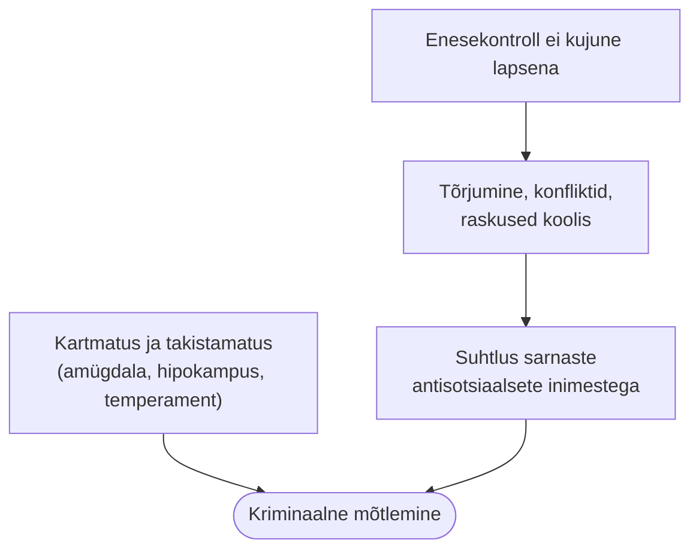
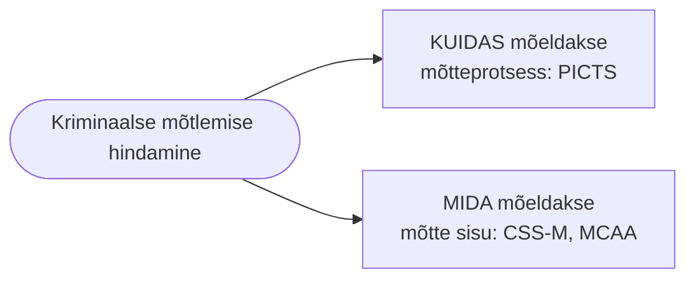
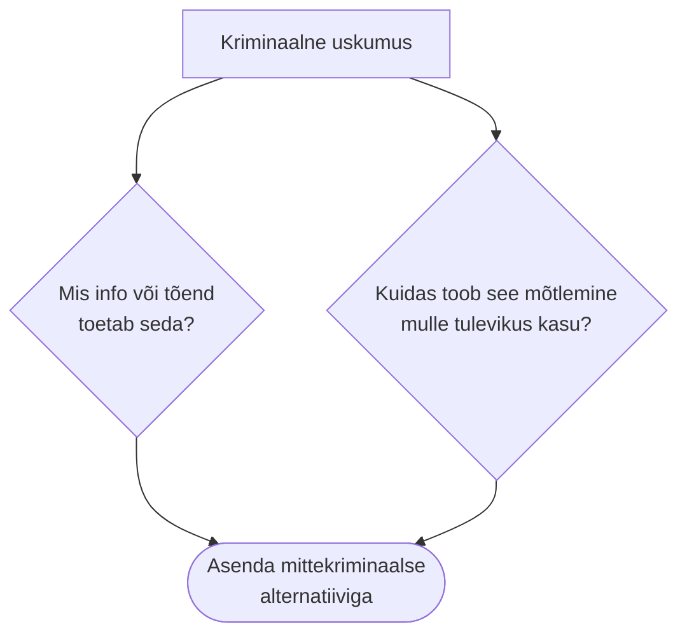

# TUND 3
<!-- Allikas: Vangla_psuhholoogia/01_ajalugu_ja_teooriad/T03_kriminaalne_motlemine.md (3 peatükki) -->
plokk: Kriminaalne mõtlemine = 1,2,3

## FAKTID
### Arvud ja lühendid
- Kriminaalne mõtlemine on üks neljast suurest retsidivismi ennustajast → 1
- Reaktiivne ja proaktiivne kriminaalne mõtlemine korreleeruvad kuni 50% → 1
- Kognitiivseid muutujaid, mis seovad mineviku ja tuleviku kuriteod, on 6 → 1
- Mõtteprotsessi hindamise küsimustik: PICTS → 1
- Mõttesisu hindamise küsimustikud: CSS-M ja MCAA → 1
- Kriminaalse mõtlemisega seotud ajuosi on 3: eesajukoor, amügdala, hipokampus → 2
- Sekkumisel on 3 faasi: ettevalmistus, tegutsemine, järelfaas → 3
- Kinnipeetav küsib endalt 2 küsimust: mis toetab minu uskumust? kuidas see mõtlemine toob mulle tulevikus kasu? → 3
### Mõisted
- Kriminaalne mõtlemine: hoiakute ja uskumuste grupp, mis on seotud kriminaalse käitumisega ja toetab kriminaalset elustiili → 1
- MIDA mõeldakse = mõtte sisu; KUIDAS mõeldakse = mõtteprotsess → 1
- Proaktiivne kriminaalne mõtlemine: eesmärgile suunatud; võib siduda psühhopaatiat ja vägivallakuritegusid → 1
- Reaktiivne kriminaalne mõtlemine: emotsioonikeskne, keskkonna muutuste või väljakutsete poolt käivitatud; seotud ainetega → 1
- Lumepalliefekt: üks kognitiivne muutuja viib teiseni → 1
- Shamani efekt: koostöö kliendiga – sensitiivsus tema sisemaailma suhtes, ekstreemsete vaadete ümberhindamine, usk muutusse → 3
- Integreerimine: mõtte ja käitumise ühtsus (järelfaas) → 3
- Võimendamine: kliendi enesetõhususe suurendamine (järelfaas) → 3
### Loetelud
- 6 kognitiivset muutujat: mõtlemise stiilid, vaenulik tõlgendamine, positiivsed ootused kuriteole, madal enesetõhusus, hedonistlikud väärtused, lühiajalised eesmärgid → 1
- Teadus on leidnud: kriminaalne mõtlemine järgneb käitumisele; erineb suuruselt, mitte liigilt; seob teisi muutujaid → 1
- Eesajukoor: otsused ja pidurdus; amügdala: emotsioonid (väiksem → vähem empaatiat ja hirmu); hipokampus: mälu ja õppimine → 2
- Ettevalmistusfaas: kriis, Shamani efekt, muutuse soovi väljaütlemine → 3
- Tegutsemise faas: kognitiivsed oskused, käitumuslikud oskused → 3
- Järelfaas: integreerimine ja võimendamine → 3
### Põhiväited
- Kriminaalne mõtlemine JÄRGNEB kriminaalsele käitumisele, ei eelne sellele → 1
- Varasemad kuriteod ennustavad kõige paremini järgmisi → 1
- Proaktiivne mõjutab lähikonna mõju, reaktiivne lähikonna valikut → 1
- Impulsiivne (reaktiivne) kuritegu on levinum kui kalkuleeritud; kaasneb mängurluse, narkootikumide ja joobes juhtimisega → 1
- Nõrk empaatiavõime ennustab proaktiivset kriminaalset mõtlemist → 1
- Kartmatus ja takistamatus seostuvad halli ainega amügdalas ja hipokampuses → temperament on oluline → 1
- Enamik sekkumisi mõjub hästi reaktiivsele, minimaalselt proaktiivsele mõtlemisele → 3
- Sekkumisel alustatakse mõtteviisi muutmisest (vastupidi kriminaalse mõtlemise tekkele) → 3

## TEEMA 1 | kriminaalne-motlemine | sihik | Definitsioon
pealkiri: Kriminaalse mõtlemise definitsioon
lyhidalt: Kriminaalne mõtlemine on hoiakud ja uskumused, mis toetavad kriminaalset elustiili – üks neljast suurest retsidivismi ennustajast. See järgneb käitumisele, mitte ei eelne. Liigid: proaktiivne (eesmärgile suunatud) ja reaktiivne (emotsioonikeskne).

### Mis on kriminaalne mõtlemine
Kriminaalne mõtlemine on **hoiakute ja uskumuste grupp**, mis on seotud kriminaalse käitumisega ja **toetab kriminaalse elustiili säilimist**. See on **üks neljast suurest retsidivismi** (korduvkuritegevuse) **ennustajast**.

Kriminaalne mõtlemine tähendab nii seda, **MIDA** kurjategija mõtleb (**mõtte sisu**), kui ka seda, **KUIDAS** ta mõtleb (**mõtteprotsess**).

### Mida teadus on leidnud
- Kriminaalne mõtlemine **järgneb kriminaalsele käitumisele**, mitte ei eelne sellele.
- Kriminaalne mõtlemine erineb inimeseti **suuruselt, aga mitte liigilt**.
- Kriminaalne mõtlemine **suurendab tulevaste kuritegude tõenäosust**, sidudes teisi kriminoloogilisi muutujaid ja mõjutajaid.

Kriminaalne mõtlemine on **sidujaks** paljudes kriminoloogilistes protsessides.

### Kuus kognitiivset muutujat
**Varasemad kuriteod ennustavad kõige paremini järgmisi.** Mineviku ja tuleviku kuritegude seost mõjutavad järgmised kognitiivsed muutujad:
1. **Kriminaalse mõtlemise stiilid.**
2. **Teiste käitumise vaenulikuna tõlgendamine.**
3. **Positiivsed ootused kuriteole.**
4. **Madal enesetõhusus** sobiva käitumise osas.
5. **Hedonistlikud** (naudingute poole püüdlevad) **väärtused.**
6. **Lühiajalised eesmärgid.**

Nendel muutujatel on **lumepalliefekt**: üks muutuja viib teiseni.

### Kuidas kriminaalset mõtlemist hinnatakse
Hindamisel eristatakse **mõtteprotsessi** ja **mõtte sisu**. Selleks on küsimustikud:
- mõtteprotsessi hindamiseks: **PICTS**;
- mõtte sisu hindamiseks: **CSS-M** ja **MCAA**.

### Kaks liiki: proaktiivne ja reaktiivne
**Proaktiivne kriminaalne mõtlemine:**
- **eesmärgile suunatud** mõtteviis, et saavutada mõni kriminaalne või antisotsiaalne siht;
- võib olla **sidujaks psühhopaatia ja vägivaldsete kuritegude** vahel.

**Reaktiivne kriminaalne mõtlemine:**
- korreleerub proaktiivsega üsna palju (**kuni 50%**);
- **emotsioonikeskne** mõtteviis, mille käivitavad keskkonna muutused või väljakutsed;
- seotud **ainete kuritarvitamisega**.

Erinevused:
- Proaktiivne kriminaalne mõtlemine mõjutab **lähikonna mõju**, reaktiivne mõjutab **lähikonna valikut**.
- **Impulsiivne (reaktiivne)** kriminaalne käitumine on **levinum** kui kalkuleeritud (proaktiivne) ja kaasneb üldiselt patoloogilise mängurluse, narkootikumide tarvitamise ja joobes juhtimisega.
- **Nõrgalt arenenud empaatiavõime ennustab proaktiivset** kriminaalset mõtlemist.

### Kuidas kriminaalne mõtlemine kujuneb
Kriminaalset mõtlemist seotakse **kartmatuse ja takistamatusega**. Neid omadusi uurides on leitud, et nendega on seotud **hall aine amügdalas ja hipokampuses**. Kuna neid ajuosi seostatakse ka temperamendi kujunemisega, on ka **temperament** kriminaalse käitumise kujunemisel oluline.

Oluline on ka **enesekontrolli kujunemine lapsena**. Kui enesekontroll ei kujune, on rohkem tõrjumist, konflikte ja raskusi koolis. See viib omakorda suhtlemiseni sarnaste inimestega, kes samuti käituvad antisotsiaalselt.

### SKEEM
```joonis
radiaal("Kuus muutujat, mis seovad mineviku ja tuleviku kuriteod", "Lumepalli-efekt", ["Kriminaalse mõtlemise stiilid", "Vaenulik tõlgendamine", "Positiivsed ootused kuriteole", "Madal enesetõhusus", "Hedonistlikud väärtused", "Lühiajalised eesmärgid"], varv_kesk="punane", varv="oranz", all="Üks muutuja viib teiseni – need võimendavad üksteist.")
```
```json
{"tyyp": "vordlus", "pealkiri": "Kaks liiki", "veerud": ["Proaktiivne", "Reaktiivne"], "read": [{"silt": "Mis see on", "lahtrid": ["**eesmärgile suunatud** – kriminaalse sihi saavutamiseks", "**emotsioonikeskne** – reaktsioon keskkonna muutusele või väljakutsele"]}, {"silt": "Seos", "lahtrid": ["võib siduda psühhopaatiat ja vägivaldseid kuritegusid; nõrk empaatia ennustab", "seotud ainete kuritarvitamisega; impulsiivne käitumine on levinum"]}, {"silt": "Mõju lähikonnale", "lahtrid": ["mõjutab **lähikonna mõju**", "mõjutab **lähikonna valikut**"]}, {"silt": "Sekkumine", "lahtrid": ["tavalistel sekkumistel minimaalne mõju; vaja väärtusi ja moraalseid otsuseid", "sekkumised mõjuvad hästi"]}]}
```



### INSPEKTOR
Liigi eristamine aitab valida, mida teha: reaktiivse puhul aitavad oskused (emotsioonide juhtimine, ainetest loobumine), proaktiivse puhul tuleb tegeleda väärtuste ja kuriteo „kasu” ootustega.
olukord: Kinnipeetav A planeeris kuid pangakaardipettusi, et osta kallis auto ja näidata sõpradele, kui edukas ta on. Kinnipeetav B lõi baaris joobes meest, kes teda tõukas.
mida teha: A on proaktiivne: eesmärk (raha, staatus) ja kalkuleeritud tegevus – tuleb tegeleda väärtuste ja positiivsete ootustega kuriteole. B on reaktiivne: emotsioon ja ained, impulsiivne reaktsioon – aitavad emotsioonide juhtimise oskused ja alkoholist loobumine.

## TEEMA 2 | ajuosad | aju | Ajuosad
pealkiri: Ajuosad, mis seonduvad kriminaalse mõtlemisega
lyhidalt: Kriminaalse mõtlemisega seostatakse kolme ajuosa: eesajukoor (otsused ja pidurdus), amügdala (emotsioonid; väiksem amügdala vähendab empaatiat ja hirmu) ja hipokampus (mälu ja õppimine).

### Kolm ajuosa
1. **Eesajukoor (prefrontaalne korteks)** – vastutab **otsuste tegemise ja pidurdusmehhanismide** eest. Sellel on oluline roll keerulistes kognitiivsetes, emotsionaalsetes ja käitumuslikes tegevustes.
2. **Amügdala (mandeltuum)** – aju **emotsioonide keskus**. Kriminaalse käitumise puhul võib amügdala olla **väiksem**, mis **vähendab empaatiat ja hirmu kogemist**.
3. **Hipokampus** – oluline **mäletamisel, õppimisel**, seoste loomisel ja mälestuste töötlemisel.

### Seos eelmise teemaga
Eelmises teemas nimetatud **kartmatust ja takistamatust** seostatakse halli ainega **amügdalas ja hipokampuses** – samades ajuosades, mis on seotud ka temperamendiga.

### SKEEM
```joonis
radiaal("Kolm ajuosa", "Kriminaalne mõtlemine", ["Eesajukoor: otsused ja pidurdus", "Amügdala: emotsioonid; väiksem → vähem empaatiat ja hirmu", "Hipokampus: mälu ja õppimine"], varv_kesk="lilla", varv="sinine")
```
```json
{"tyyp": "kaardid", "pealkiri": "Ajuosad, mis seonduvad kriminaalse mõtlemisega", "kaardid": [{"pealkiri": "Eesajukoor (prefrontaalne korteks)", "silt": "1", "tekst": "Otsuste tegemine ja **pidurdusmehhanismid**. Oluline keerulistes kognitiivsetes, emotsionaalsetes ja käitumuslikes tegevustes."}, {"pealkiri": "Amügdala (mandeltuum)", "silt": "2", "tekst": "Aju **emotsioonide keskus**. Kriminaalse käitumise puhul võib olla väiksem – see vähendab empaatiat ja hirmu kogemist.", "toon": "b"}, {"pealkiri": "Hipokampus", "silt": "3", "tekst": "**Mäletamine, õppimine**, seoste loomine ja mälestuste töötlemine."}]}
```

### INSPEKTOR
Kui kinnipeetav ei paista tundvat hirmu ega kaastunnet, võib sellel olla ka bioloogiline taust. See ei õigusta tegu, kuid selgitab, miks hirmutamine ja moraalilugemine ei pruugi mõjuda – vaja on selgeid reegleid ja harjutamist.
olukord: Ametnik hoiatab kinnipeetavat korduvalt karmide tagajärgede eest, kuid kinnipeetav jääb täiesti ükskõikseks.
mida teha: Väiksema hirmu kogemisega inimest ei pruugi hirmutamine mõjutada. Tõhusam on järjepidev reeglite rakendamine, kohene tagajärg (vt tund 2, operantne tingimine) ja positiivse käitumise tasustamine.

## TEEMA 3 | sekkumine | voti | Sekkumised
pealkiri: Kriminaalsele mõtlemisele suunatud sekkumised
lyhidalt: Enamik sekkumisi mõjub hästi reaktiivsele, kuid vähe proaktiivsele kriminaalsele mõtlemisele. Tüüpilisel sekkumisel on kolm faasi: ettevalmistus (kriis, Shamani efekt, muutuse väljaütlemine), tegutsemine (kognitiivsed ja käitumuslikud oskused) ja järelfaas (integreerimine, võimendamine).

### Millele sekkumised mõjuvad
Enamik sekkumisi on seotud kriminaalse käitumisega ja **mõjuvad tugevalt reaktiivsele** kriminaalsele mõtlemisele, kuid **proaktiivsele on mõju minimaalne**.

Proaktiivse kriminaalse mõtlemise sekkumised peaksid:
- toetama **moraalselt sobivate otsuste** tegemist;
- aitama **väärtusi selgeks** teha;
- tegelema teadaolevate kognitiivsete näitajatega, näiteks **positiivsete ootustega kuritegudele**.

### Ettevalmistusfaas
- Tekib **kriis**: kinnipeetav saab aru, et kriminaalne eluviis enam ei tööta ja negatiivsed mõjud on suuremad kui hoidvad.
- Kriisi algatamiseks palutakse tal nimetada **inimesi, kellele ta on võib-olla haiget teinud**, **võimalusi, millest ta on ilma jäänud**, **suhteid, mis on kaotsi läinud**, ja **piinlikke hetki**, mis on elustiili tõttu juhtunud.
- Selleks, et kriis saaks alata, on vaja ka **Shamani efekti** ja **avalikku avaldust muutumisest**.

**Shamani efekt** tähendab koostööd kliendiga:
- näidata tundlikkust kliendi sisemaailma suhtes sobiva **empaatia, tõlgenduse ja ennustamise** abil;
- õpetada kliendile, kuidas **ümber hinnata ekstreemseid vaatenurki**;
- panna klient mõistma, et muutus on **vajalik, võimalik ja tehtav**.

**Muutuse soovi väljaütlemine:** muutuse plaan, mis on öeldud välja **publiku ees** (ka nähtamatu publiku ees), on **tugevam ja pikemaajalisem** kui plaan, mida välja ei öelda.

### Tegutsemise faas: kognitiivsed oskused
- Kriminaalne mõtlemine järgneb kriminaalsele käitumisele – sekkumisel on vastupidi: **alustatakse mõtteviisi muutmisest**.
- Õpitakse **ära tundma ja vastu võitlema** kriminaalsetele mõtteprotsessidele.
- Kinnipeetav saab **õpetlikud juhised** mõtlemise stiilide kohta.
- Tal peab olema võimalus **märgata kriminaalset mõtlemist teistes** (nt rääkides teiste käitumisest, videod vms).
- Talle antakse **treeningharjutused** mõtlemise stiilide kohta ja **kohest tagasisidet**, kui ta neid kasutab.
- Talle õpetatakse, kuidas ise oma kriminaalsetele mõtteprotsessidele **vastu hakata** ja asendada need mittekriminaalsete alternatiividega. Selleks küsib ta endalt **kaks küsimust**:
  1. **Mis info või tõend toetab minu uskumust?**
  2. **Kuidas toob see mõtlemine mulle tulevikus kasu?**

### Tegutsemise faas: käitumuslikud oskused
- Õpitu **rakendamine**: rollimängud, kodutööd, harjutamine.
- Alguses õpitakse **kindlas ruumis ja seltskonnas**, kus teda toetavad sekkuja ja teiste tagasiside. Hiljem hakkab ta õpitut kasutama **oma elus samm-sammult**.

### Järelfaas
Kliendiga tuleb kohtuda ka **pärast aktiivse sekkumise lõppu**. Hilisemate kohtumiste teemad:
- **Integreerimine** – kognitiivsete ja käitumuslike osade ühendamine; kliendile meenutatakse, et oluline on **mõtte ja käitumise ühtsus**.
- **Võimendamine** – kliendi **enesetõhususe** suurendamine, näiteks kodutööde lõpetamise ja tugevuste esiletoomise kaudu.

### SKEEM
```joonis
voog("Tüüpilise sekkumise faasid", [("Ettevalmistus: kriis", "kriminaalne eluviis ei tööta; Shamani efekt; muutuse soov välja öeldud"), ("Tegutsemine: kognitiivsed oskused", "mõtteprotsessid ära tunda ja asendada"), ("Tegutsemine: käitumuslikud oskused", "rollimängud, kodutööd – algul toetavas keskkonnas"), ("Järelfaas", "integreerimine ja võimendamine")], varvid=["punane", "kollane", "sinine", "roheline"])
```


### INSPEKTOR
Inspektor-kontaktisik ei vii programmi läbi, kuid saab toetada kõiki faase: märgata kriisi, julgustada muutust välja ütlema ja hiljem tugevdada enesetõhusust.
olukord: Kinnipeetav ütleb: „Kõik politseinikud ja ametnikud on mu vastu, seepärast pole mõtet reegleid täita.”
mida teha: Ametnik ei vaidle, vaid aitab tal kasutada kahte küsimust. Esiteks: mis seda uskumust toetab – kas tõesti kõik, kas keegi on teda ka aidanud või õiglaselt kohelnud? Teiseks: kuidas see mõtlemine talle tulevikus kasu toob – see on toonud rikkumisi ja karistusi; mida ta tahaks saavutada ja kas reeglite täitmine aitaks sinna jõuda?
