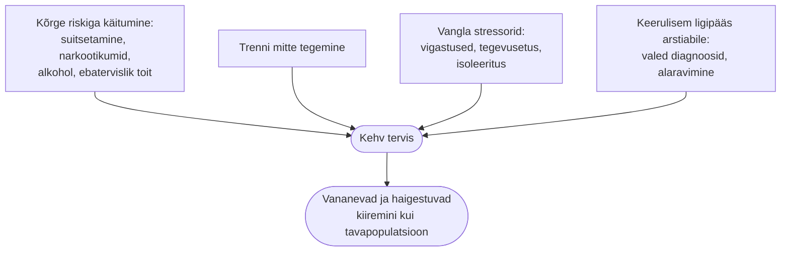
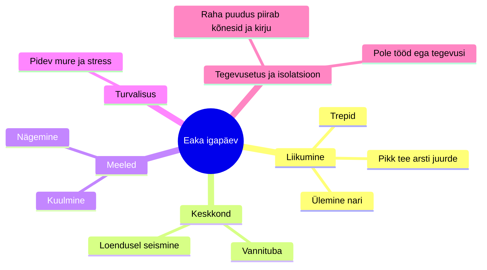
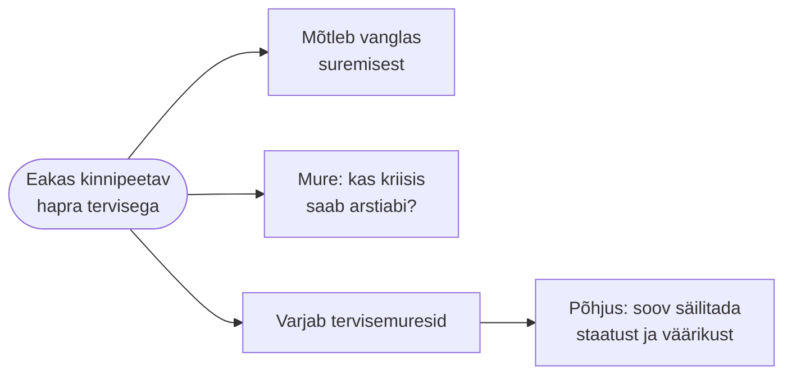
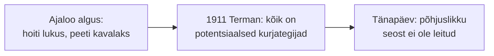
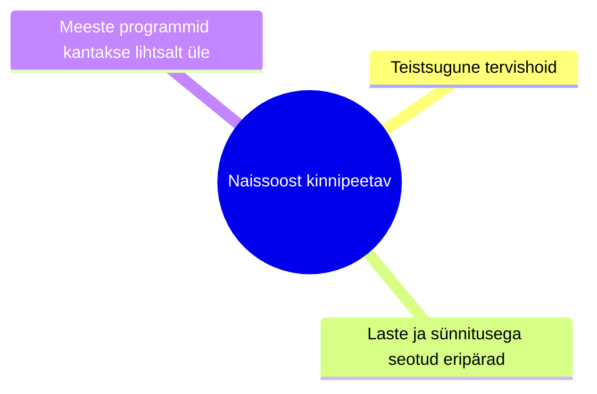
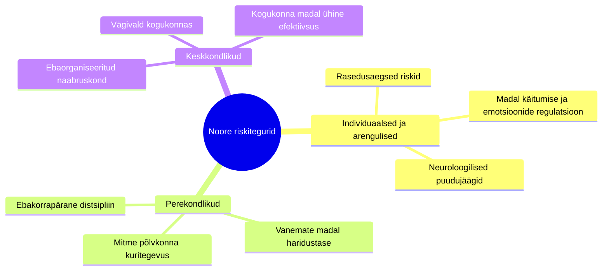

```mermaid
%% pealkiri: Vangistatud noored võrreldes tavapopulatsiooniga
%% alt: Psühhoosi 10 korda, ATH-d 2–4 korda ja käitumishäireid 5–20 korda rohkem kui tavapopulatsioonil. Tulp näitab vahemiku ülemist piiri, tumedam osa alumist.
xychart-beta
  title "Mitu korda sagedamini (ülemine ja alumine piir)"
  x-axis ["Psühhoos", "ATH", "Käitumishäired"]
  y-axis "korda" 0 --> 20
  bar [10, 4, 20]
  bar [10, 2, 5]
```

# TUND 7
<!-- Allikas: Vangla_psuhholoogia/03_kinnipeetavate_grupid_ja_suhtlemine/T07_haavatavamad_grupid.md (6 peatükki) -->
plokk: Tuvastamine ja eakad = 1,2,3
plokk: Teised haavatavad grupid = 4,5,6

## FAKTID
### Arvud
- Vangistatud noortel esineb psühhoosi 10 korda rohkem kui tavapopulatsioonil → 6
- Vangistatud noortel esineb aktiivsus- ja tähelepanuhäiret (ATH) 2–4 korda rohkem → 6
- Vangistatud noortel esineb käitumishäireid 5–20 korda rohkem → 6
- Haavatava kinnipeetava tunnuseid on 6 → 1
- Lewis Terman, 1911: „kõik vaimse mahajäämusega inimesed on potentsiaalsed kriminaalid” (tänapäeval ümber lükatud) → 4
- McMurran, 2012: mida kõrgema riskiga asutuses inimene on, seda varem toimus tema esimene rikkumine → 4
### Loetelud
- 6 haavatavuse tunnust: psühhiaatriline diagnoos, madal haridustase, nõrk sotsiaalne tugi, varasem ohvrikogemus, noor vanus, puudulikud toimetulekuoskused → 1
- Eakate kehva tervise 4 põhjust: kõrge riskiga käitumine, trenni mitte tegemine, vangla stressorid, keerulisem ligipääs arstiabile → 2
- Eakate 5 igapäevast väljakutset: liikumine, keskkonna piirangud, kuulmine/nägemine, turvalisus, tegevusetus ja isolatsioon → 2
- Eakale nõuavad palju energiat: asjade uuesti tuttavaks tegemine, meeldetuletamine, konfliktide vältimine, korraldustele allumine → 3
- Vaimse arengu mahajäämus – suurim abi: kommuun ja kogukond; suurim risk: ümbritsevad inimesed (väärkohtlemine, hüljatus, kehvad suhted) → 4
- Vaimse arengu mahajäämus – muud riskid: vaesus ja kehv elukeskkond, sotsiaalpoliitika (abiasutuste sulgemine), asutuse riskitase → 4
- Teekondade teooria 3 sammu: negatiivne elukogemus → kodust ärajooksmine / ained → ellujäämise tegevused (prostitutsioon, narkoäri, röov) → 5
- Naised erinevad vangistussüsteemis: teistsugune tervishoid, laste ja sünnitusega seotud eripärad, meeste programmid kantakse lihtsalt üle → 5
- Noore kriminaalse käitumise riskitegurid 3 rühmas: individuaalsed ja arengulised, perekondlikud, keskkondlikud → 6
- Perekondlikud riskitegurid: mitme põlvkonna kuritegevus, vanemate madal haridustase, ebakorrapärane vanemlik distsipliin → 6
### Põhiväited
- Kinnipeetavad vananevad ja haigestuvad tavapopulatsioonist märkimisväärselt kiiremini → 2
- Eakatel on krooniliste haiguste kohta üllatavalt madal terviseteadmiste tase → 2
- Vangla rutiinne päevakord varjab algavat kognitiivset langust ja varajast dementsust → 3
- Eakad varjavad tervisemuresid, et säilitada staatust ja väärikust → 3
- Eakad mõtlevad sageli vanglas suremisest – see on paljude suurim hirm → 3
- Vaimse arengu mahajäämuse ja kriminaalsuse vahel ei ole leitud põhjuslikku seost → 4
- Naisi ei uuritud varem; neile omistati seksistlikke põhjusi (vähem arenenud, vigane bioloogia, seksuaalsed ihad) → 5
- Teekondade teooria: tegurid ei ole naistele unikaalsed, kuid mõjuvad neile unikaalselt → 5
- Noortel kinnipeetavatel on kõrge komorbiidsus ja erakordselt kõrge ainete kuritarvitamise tase → 6

## TEEMA 1 | haavatavuse-tuvastamine | luup | Haavatavus
pealkiri: Haavatavate kinnipeetavate tuvastamine
lyhidalt: Mõned kinnipeetavad taluvad vangistusstressi halvemini kui teised. Uuringute põhjal on kuus tunnust, mille järgi haavatavat kinnipeetavat ära tunda.

### Mis teeb kinnipeetava haavatavaks
Teadusuuringute põhjal saab välja tuua tegurid, mis muudavad kinnipeetava **vangistusstressile vastuvõtlikumaks**. Mida rohkem tunnuseid ühel inimesel korraga on, seda haavatavam ta on.

Haavatava kinnipeetava 6 tunnust:
1. **Psühhiaatriline diagnoos** – tal on diagnoositud psüühikahäire.
2. **Madal haridustase.**
3. **Nõrgad sotsiaalsed toetussüsteemid** – vähe lähedasi, kellele toetuda.
4. **Varasem ohvrikogemus** – ta on varem olnud vägivalla või väärkohtlemise ohver.
5. **Noor vanus.**
6. **Puudulikud toimetulekuoskused** – ta ei oska raskustega hästi hakkama saada.

### Tunni ülesehitus
Tunni järgmistes peatükkides vaadatakse eraldi nelja haavatavamat gruppi: **eakas** kinnipeetav, **vaimse arengu mahajäämusega** kinnipeetav, **naissoost** kinnipeetav ja **noor** kinnipeetav.

### SKEEM
```joonis
radiaal("Haavatava kinnipeetava 6 tunnust", "Haavatav kinnipeetav", ["Psühhiaatriline diagnoos", "Madal haridustase", "Nõrk sotsiaalne tugi", "Varasem ohvrikogemus", "Noor vanus", "Puudulikud toimetulekuoskused"], all="Mida rohkem tunnuseid korraga, seda haavatavam.")
```

### INSPEKTOR
Inspektor-kontaktisik saab tunnused üles märkida ja arvestada neid suhtlemisel (lihtsam keel, rohkem selgitusi) ja paigutuse ettepanekutes. Üks tunnus ei tee inimest veel haavatavaks – vaata, mitu tunnust kokku tuleb.
olukord: Uus 19-aastane kinnipeetav on lõpetanud ainult põhikooli, tal ei ole lähedasi ja ta räägib, et teda kiusati lastekodus.
mida teha: Tal on korraga neli tunnust: noor vanus, madal haridus, nõrk sotsiaalne tugi ja varasem ohvrikogemus. Ametnik annab sellest teada, et seda arvestataks paigutusel, selgitab reegleid lihtsalt ja kontrollib tema heaolu sagedamini.

## TEEMA 2 | eakas-kinnipeetav | kepp | Eakas kinnipeetav
pealkiri: Eakas kinnipeetav
lyhidalt: Kinnipeetavad vananevad ja haigestuvad tavapopulatsioonist märkimisväärselt kiiremini. Vanglad ei ole eakatele ehitatud: neil on raskusi liikumise, meelte, turvalisuse ja üksindusega.

### Eakas kinnipeetav
Kinnipeetavate **keskmine vanus tõuseb** ja vanglad ei ole sageli eakamate kinnipeetavate jaoks sobivalt ehitatud.

Kinnipeetavad **vananevad ja haigestuvad võrreldes tavapopulatsiooniga märkimisväärselt kiiremini**. See tekitab vanglas omad väljakutsed.

Eakatel kinnipeetavatel on sageli palju kroonilisi haigusi, aga nende **terviseteadmiste tase on üllatavalt madal**. Seepärast tuleb neid näiteks harida – see on vanglale uus nõudmine.

### Miks eakate tervis on kehv
Eakate kinnipeetavate kehva tervise põhjused on **varasemad elustiili ja sotsiaalmajanduslikud tegurid**:
1. **Kõrge riskiga käitumine:** suitsetamine, narkootikumid, alkohol, ebatervislik toit.
2. **Trenni mitte tegemine.**
3. **Stressorid ja raskused vangla keskkonnas:** näiteks füüsilised vigastused, tegevusetus ja isoleeritus.
4. **Keerulisem ligipääs arstiabile:** valed diagnoosid ja alaravimine vangla töötajate poolt.

### Igapäevased väljakutsed
Eakatel kinnipeetavatel tuleb iga päev toime tulla probleemidega, mis mõjutavad nende elukvaliteeti ja heaolu vanglas:
- **Raskused liikumisega:** ülemisele narile ronimine, trepid, pikad jalutuskäigud arsti vastuvõtule.
- **Keskkonnast tingitud piirangud:** vannitoa kasutamine, loendusel seismine.
- **Meelte puudujäägid:** kuulmis- ja nägemisraskused takistavad suhtlemist ja keskkonnaga kohanemist.
- **Turvalisus:** mure oma turvalisuse pärast tekitab pidevat stressi.
- **Tegevusetus ja sotsiaalne isolatsioon:** pole võimalust tööl käia ega muudes tegevustes osaleda, mistõttu tekib isoleeritus ja üksindus. Raha puudumine piirab ka kõnede tegemist ja kirjade saatmist, nii et suhteid on raske hoida.

### SKEEM



### INSPEKTOR
Eaka kinnipeetava puhul tasub mõelda, kas ta saab füüsiliselt hakkama: kas ta peab ronima ülemisele narile, kas ta jõuab loendusel seista, kas ta kuuleb korraldust.
- Kui eakas ei täida korraldust, kontrolli kõigepealt, kas ta kuulis ja sai aru – see ei pruugi olla trots.
- Tegevusetus ja raha puudus lõikavad ta lähedastest ära – vaata, kas ta saab helistada ja kirjutada.
- Kroonilise haigusega eakale võib olla vaja lihtsalt selgitada, kuidas oma tervise eest hoolitseda.
olukord: 68-aastane kinnipeetav on paigutatud ülemisele narile ja käib harva jalutamas. Ta on jätnud kaks korda arsti juurde minemata.
mida teha: Pikk tee arsti juurde ja ülemine nari on eakale tüüpilised liikumisraskused. Ametnik küsib temalt rahulikult, mis on raske, ja teeb ettepaneku paigutada ta alumisele narile ning aidata vastuvõtule jõuda.

## TEEMA 3 | eaka-tervisemured | pulss | Eaka tervisemured
pealkiri: Eaka kinnipeetava tervisemured
lyhidalt: Eakatel esineb dementsust üha sagedamini, kuid vangla rutiin varjab algavat langust. Eakad kardavad vanglas surra ja varjavad tervisemuresid, et säilitada staatust ja väärikust.

### Kognitiivne langus ja dementsus
Lisaks tavalistele vaimse tervise häiretele on eakatel kinnipeetavatel sageli ka **vanusega seotud kognitiivsed probleemid**, näiteks Alzheimeri tõbi ja muud dementsuse vormid. Dementsus muutub eakate kinnipeetavate seas **aina levinumaks**.

**Vangla rutiinne päevakord ja eluolu takistavad sageli kerge kognitiivse languse ja varase dementsuse avastamist.** Kui päev on iga päev ühesugune, saab inimene harjumuse jõul hakkama ka siis, kui mälu ja mõtlemine juba nõrgenevad.

Seepärast märgatakse vaimset langust sageli **alles siis, kui olukord on juba eskaleerunud**. Selleks ajaks on teised kinnipeetavad eakat tihti **kiusanud ja ohvristanud**. See muudab eaka **agressiivseks** ja konflikte tuleb juurde.

### Kognitiivsed eripärad ja nende mõju
Ametnikud peavad arvestama eakate kognitiivsete eripäradega, näiteks **raskustega arusaamisel ja mäletamisel**. Eakale on igapäevased tegevused **väga suure energiakuluga**. Need hõlmavad:
- asjade endale uuesti tuttavaks tegemist,
- meeldetuletamist,
- konfliktide vältimist,
- korraldustele allumist.

### Hirm, haigus ja varjamine
Eakad kinnipeetavad, kellel on juba tervise- või hapram vaimne tervis, **mõtlevad sageli vanglas suremisest**. See on paljudele üks suurimaid hirme ja tekitab palju negatiivseid emotsioone.

Lisamuret tekitab vanglas **haigeks jäämine ja kriisihetkel arstiabi vajamine**, sest esineb olukordi, kus meditsiinitöötajad keelduvad ravi andmisest või takistavad seda.

Samas on eakatel **kalduvus oma tervisemuresid varjata**, isegi kui abi on kättesaadav. Põhjus: **soov säilitada oma staatust ja väärikust** teiste kinnipeetavate silmis.

### SKEEM
```joonis
voog("Miks dementsust märgatakse hilja", [("Algav kognitiivne langus", "mälu ja arusaamine nõrgenevad"), ("Vangla rutiin varjab", "ühesugune päevakord – harjumuse jõul saab hakkama"), ("Teised kiusavad ja ohvristavad", ""), ("Eakas muutub agressiivseks", "konflikte tuleb juurde – alles nüüd märgatakse")], varvid=["sinine", "kollane", "oranz", "punane"])
```


### INSPEKTOR
Eaka agressiivsus või korralduste mittetäitmine võib olla algava dementsuse või kiusamise tagajärg, mitte iseloom. Tervishoiutöötaja on kohustatud kinnipeetava terviseseisundit jälgima ([[VangS § 52 lg 2]]) – kontaktisik saab talle oma tähelepanekutest teada anda.
- Kuna eakas ei küsi ise abi (väärikus), pane tähele märke: lonkab, väldib ülemist narit, jääb jalutuskäigult maha, unustab.
- Räägi rahulikult, korda juhiseid, kontrolli, kas ta sai aru.
olukord: 72-aastane kinnipeetav jääb loendusele hiljaks ega mäleta, et teda eile hoiatati. Kambrikaaslased on hakanud teda narrima ja ta karjus ühe peale.
mida teha: See võib olla algav kognitiivne langus, mida vangla rutiin on seni varjanud; kiusamine ja agressioon on tüüpiline järg. Ametnik ei karista kohe, vaid räägib rahulikult, kordab juhiseid, teavitab tervishoiutöötajat ja jälgib kiusamist.

## TEEMA 4 | vaimse-arengu-mahajaamus | kogukond | Vaimse arengu mahajäämus
pealkiri: Vaimse arengu mahajäämusega kinnipeetav
lyhidalt: Varem peeti vaimse arengu mahajäämusega inimesi kavalateks ja potentsiaalseteks kurjategijateks, kuid põhjuslikku seost kriminaalsusega ei ole leitud. Suurim abi on kogukond, suurim risk on teda ümbritsevad inimesed.

### Ajalugu ja eelarvamus
Ajaloo alguses hoiti vaimse arengu mahajäämusega inimesi **lihtsalt lukus**. Neid peeti **kavalateks ja õelateks**, kes ainult mängivad süütut. Arvati, et vaimse arengu mahajäämus on väga tugevalt seotud kriminaalse käitumisega.

Ameerika psühholoog **Lewis Terman** ütles **1911. aastal**, et kõik kurjategijad ei ole vaimse mahajäämusega, kuid kõik vaimse mahajäämusega inimesed on potentsiaalsed kurjategijad.

### Mida uuringud näitavad
Tänaseks on teemat palju uuritud. **Põhjuslikku seost vaimse arengu mahajäämuse ja kriminaalsuse vahel ei ole leitud** – see seos on ületähtsustatud.

### Riskid ja nende maandamine
Materjalis on viis mõtet riski kohta:
1. **Peamine abiline** riski maandamisel on **kommuun ja kogukond**.
2. Samas on **suurim risk teda ümbritsevad inimesed**: pereliikmete väärkohtlemine, hüljatus ja kehvad suhted.
3. Suur risk on ka **vaesus ja kehv elukeskkond**.
4. Kuritegude risk ja vanglasse sattumine on tugevalt seotud **sotsiaalpoliitikaga**: kui abi andvaid asutusi jääb vähemaks või need suletakse, suureneb risk jälle.
5. Loeb ka **asutuse riskitase**: mida kõrgema riskiga asutuses inimene viibib, seda varem on toimunud tema kõige esimene rikkumine (McMurran, 2012).

### SKEEM

```joonis
kaks_poolt("Mis mõjutab riski", ["Kommuun ja kogukond"], ["Ümbritsevad inimesed: väärkohtlemine, hüljatus, kehvad suhted", "Vaesus ja kehv elukeskkond", "Sotsiaalpoliitika: abiasutusi jääb vähemaks", "Asutuse kõrge riskitase – esimene rikkumine varem"], vp="Peamine abi", pp="Riskid", kesk="Vaimse arengu mahajäämusega inimene")
```

### INSPEKTOR
Suhtle lühikeste lausetega, anna üks juhis korraga ja kontrolli arusaamist („Räägi mulle oma sõnadega, mida sa nüüd teed”). Aitavad kirjalikud või pildilised meeldetuletused.
- Kuna suurim risk on teda ümbritsevad inimesed, jälgi, kas teised kinnipeetavad kasutavad teda ära.
olukord: Kerge vaimse alaarenguga kinnipeetav viib teiste kinnipeetavate palvel asju ühest kambrist teise ja jääb sellega vahele.
mida teha: Teda on tõenäoliselt ära kasutatud. Ametnik selgitab reeglit lihtsalt, kontrollib arusaamist ja jälgib, kes teda kasutab; koos kolleegidega kaalutakse paigutust ja tuge.

## TEEMA 5 | naissoost-kinnipeetav | teekond | Naissoost kinnipeetav
pealkiri: Naissoost kinnipeetav
lyhidalt: Varem naisi ei uuritud ja nende kuritegusid seletati seksistlikult. Teekondade teooria järgi viivad naised kuriteoni negatiivsed elukogemused: väärkohtlemine, probleemsed suhted ja vaesus.

### Ajalugu
Varem **naisi ei uuritud** – uuringud tegelesid ainult meestega. Naiste kuritegudele omistati tänapäeva vaates **seksistlikke põhjuseid**: räägiti, et naised teevad kuritegusid, sest nad on meestest **vähem arenenud** ning neid motiveerib **vigane bioloogia** või **seksuaalsed ihad**.

### Teekondade teooria (pathways theory)
Teekondade teooria järgi satuvad naised kriminaalsetesse tegudesse **negatiivsete elukogemuste** tõttu:
- lapsepõlves väärkohtlemine või hooletusse jätmine,
- probleemsed suhted hooldajate või partneritega,
- majanduslik tõrjutus (vaesus).

Teekond käib kolmes sammus:
1. Need tegurid **ei ole naistele unikaalsed, kuid mõjuvad neile unikaalselt** (st esinevad ka meestel, aga mõjutavad naisi teisiti).
2. Naised tulevad nende teguritega toime **kodust ära joostes ja/või aineid tarvitades**.
3. Sealt viib tee **ellujäämiseks tehtavate tegevusteni**: prostitutsioon, narkootikumidega äritsemine, röövimine.

### Erinevused vangistussüsteemis
Naised erinevad vangistussüsteemis meestest järgmiselt:
- nad vajavad **teistsugust tervishoidu**,
- neil on **laste ja sünnitusega seotud eripärad**,
- sageli kantakse meestele mõeldud sekkumisprogrammid **lihtsalt naistele üle** ja lisatakse juurde mõni naistele vajalik osa.

### SKEEM
```joonis
trepp("Teekondade teooria", [("Negatiivsed elukogemused", "väärkohtlemine, suhted, vaesus"), ("Toimetulek", "kodust ärajooksmine, ained"), ("Ellujäämise tegevused", "prostitutsioon, narkoäri, röov")], varvid=["punane", "oranz", "lilla"], tipp="Tegurid ei ole naistele unikaalsed, kuid mõjuvad neile unikaalselt.")
```


### INSPEKTOR
Naissoost kinnipeetavaga töötades tasub küsida tema teekonna kohta: mis eelnes ainetele ja kuritegudele? Sageli on vaja tegeleda trauma ja suhetega, mitte ainult kuriteoga.
olukord: Naine kannab karistust narkootikumide müügi eest. Ta jooksis 15-aastaselt kodust ära, kus teda väärkoheldi, ja hakkas valuga toimetulekuks aineid tarvitama. Raha ainete jaoks teenis ta müügiga.
mida teha: See on teekondade teooria muster: negatiivne kogemus (väärkohtlemine) → toimetulek (kodust ärajooksmine, ained) → ellujäämise tegevus (müük). Ametnik ei õigusta tegu, kuid toetab abi saamist trauma ja ainetega, sest need on kuriteoni viinud teekonna osad.

## TEEMA 6 | noor-kinnipeetav | idu | Noor kinnipeetav
pealkiri: Noor kinnipeetav
lyhidalt: Noor kinnipeetav on eriliselt haavatav. Vangistatud noortel on psühhoosi 10 korda, ATH-d 2–4 korda ja käitumishäireid 5–20 korda rohkem kui tavapopulatsioonil; ainete tarvitamine on erakordselt kõrge.

### Noor kinnipeetav
Noor kinnipeetav on **eriliselt haavatav** grupp. Neil tekib juba varases eas **agressiivne ja vägivaldne käitumine**, mis omakorda aitab kaasa vaimse tervise probleemide tekkele.

### Vangistuse mõju vaimsele tervisele
Noore vangistamine mõjub tema vaimsele tervisele mitmeti negatiivselt. Võrreldes tavapopulatsiooniga esineb vangistatud noortel:
- **psühhoosi 10 korda rohkem**,
- **aktiivsus- ja tähelepanuhäiret (ATH) 2–4 korda rohkem**,
- **käitumishäireid 5–20 korda rohkem**.

See näitab, et **isiksusehäired** ja **välise käitumise häired** (ATH, käitumishäired) on tugevalt seotud kriminaalse käitumise ja käitumisprobleemidega.

Noortel kinnipeetavatel on ka **kõrge komorbiidsus** (mitu häiret korraga) ja **erakordselt kõrge ainete kuritarvitamise tase**.

### Noore kriminaalse käitumise riskitegurid
Riskitegurid jagunevad kolme rühma:
- **Individuaalsed ja arengulised tegurid:** kokkupuude rasedusaegsete riskidega; lapsepõlves madal käitumise ja emotsioonide regulatsioon; neuroloogilised puudujäägid.
- **Perekondlikud tegurid:** mitme põlvkonna käitumisprobleemid ja kuritegevus; vanemate madal haridustase; ebakorrapärane vanemlik distsipliin.
- **Keskkondlikud tegurid:** elamine sotsiaalselt ebaorganiseeritud naabruskonnas; kogukonnas esinev vägivald; kogukonna madal ühine efektiivsus (inimesed ei suuda koos korda hoida).

### SKEEM



### INSPEKTOR
Noorega töötades on eriti olulised selged reeglid, ametniku enda eeskuju ja võimalus õppida. Mõtle tema riskiteguritele kolmes rühmas – nii näed, millega saab vanglas tegeleda (oskused, haridus, ainete tarvitamine) ja millega mitte (minevik, perekond).
olukord: 18-aastane kinnipeetav on impulsiivne, satub tihti tülidesse ja räägib, et tema isa ja vanem vend on samuti vanglas olnud.
mida teha: Riskitegurid on individuaalne (madal enesekontroll) ja perekondlik (mitme põlvkonna kuritegevus). Ametnik toetab hariduse ja oskuste omandamist, on ise järjekindel eeskuju ja jälgib, kas noorel on ka ainete tarvitamise või vaimse tervise probleeme, millega abi vajab.
